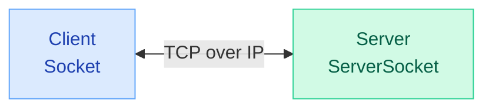
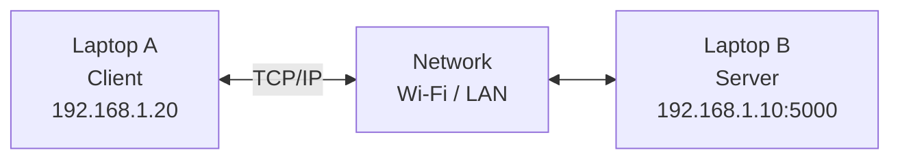

# Java TCP Client–Server Example

This example demonstrates how a Java client and server communicate using **TCP/IP**, including IP addresses, port numbers, and socket connections.

## 1. Client–Server Architecture



- **IP address:** Identifies the destination machine.
- **Port:** Identifies the service on that machine.
- **TCP:** Provides reliable, ordered byte delivery.
- **Socket:** Java's interface for TCP communication.
- **ServerSocket:** Listens for incoming TCP connections.

## 2. Server Code — `Server.java`

```java
import java.net.*;
import java.io.*;

public class Server {
    public static void main(String[] args) throws Exception {

        // Create a TCP server listening on port 5000
        try (ServerSocket server = new ServerSocket(5000)) {

            System.out.println("Waiting for client...");

            // Block until a client establishes a TCP connection
            try (Socket client = server.accept()) {

                // Display connected client and server details
                System.out.println("Client IP: " +
                    client.getInetAddress().getHostAddress());

                System.out.println("Client Port: " +
                    client.getPort());

                System.out.println("Server IP: " +
                    client.getLocalAddress().getHostAddress());

                System.out.println("Server Port: " +
                    client.getLocalPort());

                // Read data received through TCP
                BufferedReader in = new BufferedReader(
                    new InputStreamReader(client.getInputStream())
                );

                String message = in.readLine();
                System.out.println("Received: " + message);
            }
        }
    }
}
```

### Important Server Methods

| Method | Purpose |
|---|---|
| `new ServerSocket(5000)` | Starts listening for TCP connections on port 5000 |
| `server.accept()` | Waits for and accepts a client connection |
| `client.getInetAddress()` | Returns the client's IP address |
| `client.getPort()` | Returns the client's TCP port |
| `client.getLocalAddress()` | Returns the server's IP address for this connection |
| `client.getLocalPort()` | Returns the server's port (5000) |
| `client.getInputStream()` | Receives bytes over TCP |

**Note:** `accept()` blocks until a connection is established. This example handles one client and then terminates.

## 3. Client Code — `Client.java`

```java
import java.net.*;
import java.io.*;

public class Client {
    public static void main(String[] args) throws Exception {

        // Default to localhost; accept a different server address
        String host = args.length > 0 ? args[0] : "localhost";

        // Establish TCP connection to server port 5000
        try (Socket socket = new Socket(host, 5000)) {

            // Send data to the server over TCP
            PrintWriter out = new PrintWriter(
                socket.getOutputStream(), true
            );

            out.println("Hello Server");
        }
    }
}
```

### Important Client Methods

| Method | Purpose |
|---|---|
| `new Socket(host, 5000)` | Connects to the server using TCP |
| `socket.getOutputStream()` | Gets the stream used to send bytes |
| `out.println("Hello Server")` | Sends a text message followed by a newline |
| `socket.close()` | Closes the socket (automatic with try-with-resources) |

## 4. Running on the Same Machine

Both client and server run on the same computer.

```text
Computer
  |
  |-- Java Client (localhost)
  |
  |-- Java Server (port 5000)
```

### Step 1 — Compile

```bash
javac Server.java Client.java
```

### Step 2 — Start Server (Terminal 1)

```bash
java Server
```

Output:

```text
Waiting for client...
```

### Step 3 — Start Client (Terminal 2)

```bash
java Client
```

### Expected Server Output

```text
Waiting for client...
Client IP: 127.0.0.1
Client Port: 54321
Server IP: 127.0.0.1
Server Port: 5000
Received: Hello Server
```

`54321` is only an example. The operating system assigns the client's temporary (ephemeral) port.

**Why localhost?**

`localhost` refers to the same machine and usually resolves to `127.0.0.1` (IPv4) or `::1` (IPv6).

## 5. Running on Different Machines

Suppose:

- Laptop A runs the client.
- Laptop B runs the server.
- Laptop B has IP address `192.168.1.10`.



### Laptop B — Start Server

```bash
java Server
```

The server code remains unchanged.

### Laptop A — Connect to Server

```bash
java Client 192.168.1.10
```

Alternatively, use Netcat:

```bash
nc 192.168.1.10 5000
```

Then type:

```text
Hello Server
```

Example server output:

```text
Client IP: 192.168.1.20
Client Port: 54321
Server IP: 192.168.1.10
Server Port: 5000
Received: Hello Server
```

All IP addresses are examples. Replace them with actual network addresses.

**Requirements:**
- Both machines must have network connectivity.
- The server must accept connections on its network interface.
- Firewalls must allow the TCP connection on port 5000.

## 6. Same Machine vs Different Machines

| Feature | Same Machine | Different Machines |
|---|---|---|
| Server code | `ServerSocket(5000)` | `ServerSocket(5000)` |
| Client address | `localhost` | Server's reachable IP |
| Example IP | `127.0.0.1` | `192.168.1.10` |
| TCP required | Yes | Yes |
| IP required | Yes (loopback) | Yes |
| Network path | Internal loopback | LAN / Internet |
| HTTP required | No | No |

**Important:** The server code does not change. The client must connect to the correct server IP address and port.

## 7. Where Does TCP/IP Actually Happen?

```text
Java Client
    |
    | new Socket(serverIP, 5000)
    v
Operating System
    |
    | TCP - Connection, ports, reliable delivery
    v
    | IP - Source/destination IP addresses, routing
    v
Network
    |
    v
Server Operating System
    |
    | IP -> TCP
    v
Java ServerSocket
    |
    | accept()
    v
Server Application
```

Java provides the socket API, while the operating system implements TCP/IP.

We do not manually create TCP headers, IP headers, or implement retransmission.

## 8. TCP vs HTTP in Java

| Feature | Raw TCP | HTTP (Spring Boot) |
|---|---|---|
| Server API | `ServerSocket` | Embedded HTTP server (e.g., Tomcat) |
| Client API | `Socket` | `HttpClient` / Browser |
| Application message | Custom text / binary | HTTP request / response |
| Connection handling | Written by application | Handled by HTTP server |
| Transport | TCP | TCP for HTTP/1.1 and HTTP/2 |
| IP | Handled by OS | Handled by OS |

**Remember:**
- `Socket` and `ServerSocket` provide TCP communication.
- TCP uses IP underneath.
- TCP can be used without HTTP.
- HTTP/1.1 and HTTP/2 use TCP/IP.
- A Java HTTP server handles the socket communication so application code can focus on HTTP requests and responses.

---

[Back to TCP vs IP Notes](./tcp-vs-ip.md)

