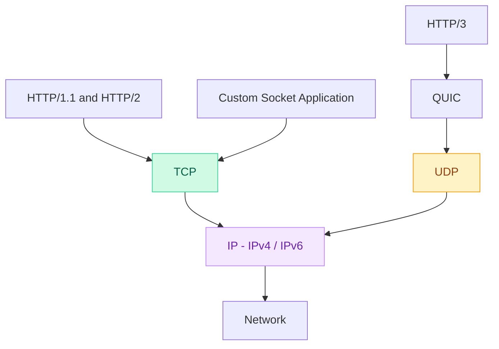

# TCP vs IP (TCP/IP)

TCP and IP are different protocols that work together to enable communication between applications across a network.

## 1. Protocol Relationship: HTTP, TCP, UDP, and IP



**Important:**
- TCP uses IP, but IP does not require TCP.
- IP can carry TCP, UDP, and other protocols.
- HTTP/1.1 and HTTP/2 use TCP.
- HTTP/3 uses QUIC over UDP.
- Applications can also communicate directly over TCP without HTTP.

## 2. Client and Server Networking Layers

Both the client and server machines have their own networking layers. The network connects the two machines.

```mermaid
flowchart LR
    subgraph CLIENT["Client Machine"]
        direction TB
        CA["Application Layer<br/>HTTP / Custom Protocol"]
        CT["Transport Layer<br/>TCP / UDP"]
        CI["Internet Layer<br/>IP"]
        CN["Network Access<br/>Wi-Fi / Ethernet"]

        CA --> CT --> CI --> CN
    end

    N["Network<br/>Routers / Switches / Internet"]

    subgraph SERVER["Server Machine"]
        direction BT
        SN["Network Access<br/>Wi-Fi / Ethernet"]
        SI["Internet Layer<br/>IP"]
        ST["Transport Layer<br/>TCP / UDP"]
        SA["Application Layer<br/>HTTP / Custom Protocol"]

        SN --> SI --> ST --> SA
    end

    CN <--> N
    N <--> SN

    style CA fill:#dbeafe,color:#1e40af
    style CT fill:#d1fae5,color:#065f46
    style CI fill:#f3e8ff,color:#6b21a8
    style CN fill:#f3f4f6,color:#374151

    style SA fill:#dbeafe,color:#1e40af
    style ST fill:#d1fae5,color:#065f46
    style SI fill:#f3e8ff,color:#6b21a8
    style SN fill:#f3f4f6,color:#374151
```



### Understanding the Layers

| Layer | Responsibility | Example |
|---|---|---|
| Application | Defines application communication | HTTP, custom chat protocol |
| Transport | Communication between applications using ports | TCP, UDP |
| Internet | IP addressing and packet routing | IPv4, IPv6 |
| Network Access | Transfers data over local network links | Wi-Fi, Ethernet |

**Key concepts:**
- Client and server are endpoints, not networking layers.
- Each machine has its own networking stack.
- Data moves down the client's layers, across the network, and up the server's layers.
- Routers and switches help transfer data between machines.
- The network itself also uses networking protocols.

### Example: HTTP over TCP/IP

```text
Client Machine
    |
    v
Application Layer (HTTP)
    |
    v
Transport Layer (TCP)
    |
    v
Internet Layer (IP)
    |
    v
Network Access (Wi-Fi / Ethernet)
    |
    v
========== NETWORK ==========
    |
    v
Network Access (Wi-Fi / Ethernet)
    |
    v
Internet Layer (IP)
    |
    v
Transport Layer (TCP)
    |
    v
Application Layer (HTTP)
    |
    v
Server Application
```

This is the simplified request path for HTTP/1.1 or HTTP/2. For HTTPS, TLS also provides encryption.

The server's response travels back through the corresponding layers.

**DNS:** When the client uses a domain name, DNS typically resolves it to an IP address before a new connection is established. DNS is an application-layer protocol, not a separate networking layer.

## 3. IP vs TCP

| Feature | IP (Internet Protocol) | TCP (Transmission Control Protocol) |
|---|---|---|
| Layer | Internet / Network | Transport |
| Purpose | Addressing and routing packets | Reliable, ordered data delivery |
| Identifies | Source and destination IP addresses | Source and destination ports |
| Reliability | No delivery guarantee | Retransmits lost data |
| Connection | Connectionless | Connection-oriented |
| Example | `192.168.1.10` | Port `5000` |
| Java | `InetAddress` | `Socket`, `ServerSocket` |

### Key Points

- **IP:** Determines where packets should go using IP addresses.
- **TCP:** Provides reliable, ordered delivery between applications.
- **TCP over IP:** TCP segments are carried inside IP packets.
- **Port:** Identifies the destination service on a machine.
- **Operating System:** Implements TCP/IP internally.

**Remember:** IP identifies the machine/network interface; the port identifies the service on that machine.

## 4. How TCP/IP Works

Example: A client connects to a server at `192.168.1.10:5000`.

1. **Application:** Creates data to send.
2. **TCP:** Establishes a connection and manages reliable byte delivery.
3. **IP:** Adds source and destination IP addresses and routes packets.
4. **Network Access:** Transmits data over network links.
5. **Server:** Receives the data and processes it through the layers in reverse.

### TCP vs UDP

| Feature | TCP | UDP |
|---|---|---|
| Connection | Connection-oriented | Connectionless |
| Reliability | Reliable delivery | No built-in guarantee |
| Ordering | Preserves byte order | No ordering guarantee |
| Retransmission | Yes | No built-in retransmission |
| Java API | `Socket`, `ServerSocket` | `DatagramSocket`, `DatagramPacket` |

Both TCP and UDP commonly use IP underneath.

## 5. Where Do We See TCP/IP in Java?

| Java Code | What it represents |
|---|---|
| `new ServerSocket(5000)` | Creates a TCP server listening on port 5000 |
| `server.accept()` | Accepts an incoming TCP connection |
| `new Socket("192.168.1.10", 5000)` | Connects to the server's IP address and TCP port |
| `socket.getInetAddress()` | Gets the remote machine's IP address |
| `socket.getLocalAddress()` | Gets the local IP address used by the connection |
| `socket.getInputStream()` | Reads bytes received through TCP |
| `socket.getOutputStream()` | Writes bytes to be sent through TCP |

### Where Is TCP/IP Implemented?

```text
Java Application
      |
      | Socket / ServerSocket
      v
Operating System
      |
      | TCP - connection and reliability
      v
      | IP - addressing and routing
      v
Network Interface
      |
      v
Network
```

**Remember:**
- Java's `Socket` and `ServerSocket` use TCP.
- TCP uses IP underneath.
- Java and the operating system handle the networking details.
- Applications do not need to implement TCP/IP manually.

## 6. HTTP vs Raw TCP

| Concept | Raw TCP Application | HTTP Application |
|---|---|---|
| Application protocol | Custom message format | HTTP |
| Transport | TCP | TCP for HTTP/1.1 and HTTP/2 |
| Java server | `ServerSocket` | Spring Boot / Embedded Tomcat |
| Client | Java `Socket` / Netcat | Browser / `HttpClient` / curl |
| Request handling | Read/write socket streams | HTTP endpoints like `@GetMapping` |
| TCP connection handling | Application code manages sockets | HTTP server/framework manages sockets |
| IP handling | Operating system | Operating system |
| REST required? | No | No |

**Key takeaway:** HTTP is an application-layer protocol that typically runs over TCP/IP. Using Spring Boot, the web server manages HTTP and the underlying TCP connections, so application developers usually do not need to write `ServerSocket` code.

## 7. Java TCP Client–Server Code Example

[View Java TCP Client–Server Example](./tcp-client-server.md)

*Separate file containing the Java server, client, connection setup, IP address demonstration, and execution instructions.*
